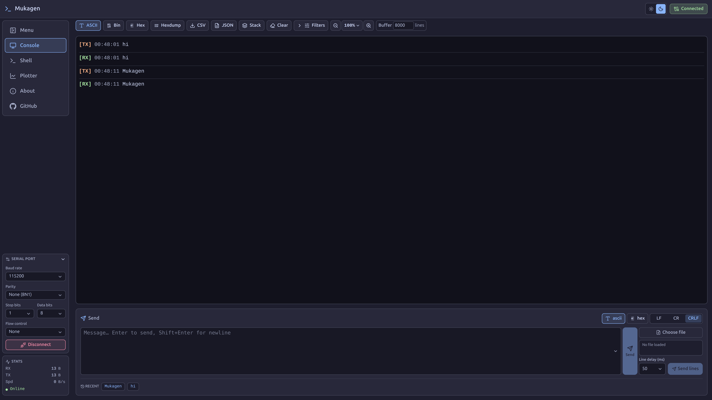
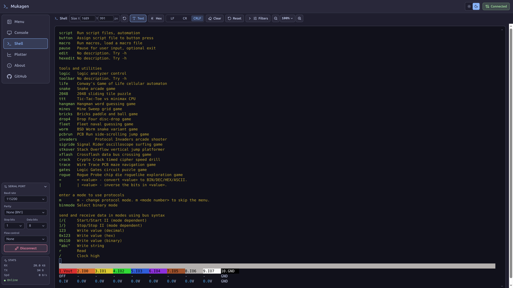
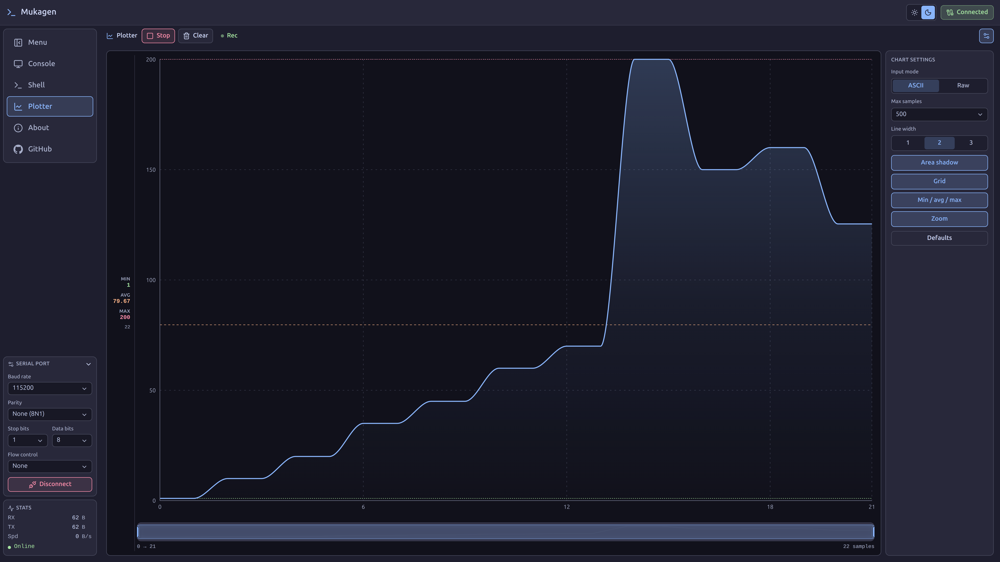

# Mukagen

A browser-based serial terminal and telemetry dashboard for embedded development. Connect to a serial device, inspect traffic as text or bytes, use an interactive terminal, and plot numeric samples through the Web Serial API.

[Open the web app](https://reza-bakhshi.github.io/Mukagen/)



## What it does

| View | Use |
|---|---|
| Console monitor | Inspect ASCII, binary, hex, and hexdump output; filter RX/TX traffic and export captures |
| Interactive shell | Work with a serial command line through an xterm.js terminal |
| Telemetry plotter | Plot incoming numeric samples and inspect minimum, maximum, and average values |
| Transmit panel | Send text or hex, select line endings, reuse commands, and send files with a line delay |

The workbench also offers configurable serial settings, light and dark themes, adjustable panels, and persistent browser preferences.

## Connect a device

1. Open the app in a browser with Web Serial support, such as desktop Chrome or Edge. It needs HTTPS or a localhost development server.
2. Attach your serial device and match its baud rate, data bits, parity, stop bits, and flow-control settings.
3. Click **Connect** and choose the port in the browser's device picker.
4. Use the console, shell, or plotter view for your task.

The browser uses your operating system's serial device support. A USB-to-serial adapter may still require a driver or local device permissions. Close other applications using the same port before connecting.

## Telemetry formats

| Mode | Input format | Example |
|---|---|---|
| ASCII | Numbers separated by whitespace, commas, or semicolons; newline-delimited output is recommended | `23.5\n` |
| Raw binary | IEEE-754 64-bit floating-point samples, little-endian, eight bytes per sample | A packed little-endian `double` |

The current plotter consumes a single sample stream. Multiple values on a line become successive samples, rather than separate named channels. JSON objects are not a supported telemetry format. See [waveformParse.ts](src/utils/waveformParse.ts).

For example, an Arduino device can send a numeric reading with:

```cpp
Serial.println(23.5);
```

## Send commands and capture data

- Choose ASCII or hexadecimal transmission and the line ending expected by your device.
- Use the file-send delay when a device needs time between commands.
- Export console data as CSV or JSON for offline inspection.
- The shell's reset action sends terminal recovery commands to the connected device; use it with devices that understand those commands.

## Local development

Use a Node.js version compatible with the Vite version in [package.json](package.json), together with npm.

```bash
git clone https://github.com/reza-bakhshi/Mukagen.git
cd Mukagen
npm ci
npm run dev
```

Open the localhost URL printed by Vite.

```bash
npm run build    # TypeScript check and production build in dist/
npm run lint     # ESLint
npm run preview  # Preview the production build
```

## Source guide

| Path | Purpose |
|---|---|
| [src/hooks/useSerialPort.ts](src/hooks/useSerialPort.ts) | Serial connection and I/O |
| [src/views](src/views) | Console, shell, plotter, settings, and About screens |
| [src/components](src/components) | Reusable workbench controls |
| [src/utils](src/utils) | Parsing, capture filtering, export, and formatting |
| [src/config](src/config) | About content and application links |

Built with React, TypeScript, Vite, Zustand, xterm.js, and Recharts.

## Troubleshooting

| Symptom | Check |
|---|---|
| Serial API is unavailable | Use a supported desktop browser over HTTPS or localhost |
| Port is missing or busy | Adapter driver, USB connection, device permissions, and competing terminal programs |
| Text is garbled | Baud rate, parity, data bits, and stop bits |
| Plot is empty or incorrect | Selected input mode and exact numeric/binary format |
| Linux access is denied | Serial-device group membership and browser sandbox permissions |

For TTL UART wiring, match the target's logic voltage, cross TX/RX, and connect a common ground.




## License status

No license file is committed in this repository. The application About screen currently says `GNU`, but does not identify a specific license or version. Reuse and redistribution terms need to be clarified by the maintainer; dependencies retain their respective licenses.
